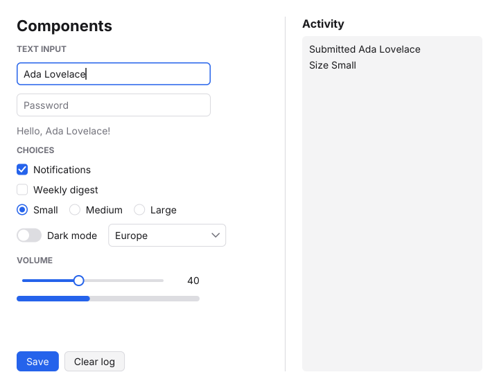

# MyZig

[](https://github.com/abishek77s/myzig/actions/workflows/run_tests.yml)

**Native desktop UI in Zig, drawn by MyZig itself on the GPU (Metal, Vulkan
or OpenGL) or the CPU, on Linux, Windows and macOS.** Views are Zig functions of the
app's state, laid out with flexbox; no webview, no toolkit, no runtime.
MyZig began as a port of the native UI of [MyGo](https://github.com/egoist/mygo)
and measures itself against [gpui-fast](https://github.com/longbridge/gpui-fast).



```zig
const myzig = @import("myzig");
const ui = myzig.ui;

const Counter = struct { n: i64 = 0 };

fn view(s: *Counter, c: *ui.Context) void {
    c.column(.{ .fill = true, .center = true, .gap = 16 });
    defer c.end();
    c.textf("{d}", .{s.n}, .{ .size = 56, .bold = true });
    {
        c.row(.{ .gap = 8 });
        defer c.end();
        if (c.button("−", .{ .key = "decrement", .width = 44 })) s.n -= 1;
        if (c.button("Reset", .{ .disabled = s.n == 0 })) s.n = 0;
        if (c.button("+", .{ .key = "increment", .primary = true, .width = 44 })) s.n += 1;
    }
}

pub fn main() !void {
    var s = Counter{};
    try myzig.run(&s, view, .{ .title = "Counter", .width = 360, .height = 260 });
}
```

## Getting started

You need [Zig](https://ziglang.org/download/) 0.15.2. Nothing else on
Windows or macOS (no Xcode, no SDK); on Linux, the X11 development
libraries (`libx11-dev libxext-dev` on Debian and Ubuntu). GPU drivers and
macOS's frameworks are opened at run time, so building needs no Vulkan SDK,
OpenGL headers or Metal toolchain.

```sh
zig build gallery                        # every control, with a dark theme
zig build counter                        # MyGo's counter-native
zig build quotes                         # a table of prices streaming every frame
zig build list                           # 10,000 rows (AUTOSCROLL=1 scrolls them)
zig build events                         # the input a window gets, as it comes
zig build editor -- notes.txt            # a text editor: line numbers, undo, Ctrl+S
zig build test                           # the views, clicked and typed at without a window
zig build bench -Doptimize=ReleaseFast   # what a frame costs, headless
```

On Windows, in PowerShell:

```powershell
zig build gallery -Doptimize=ReleaseFast
$env:MYZIG_RENDERER = "vulkan"; zig build quotes -Doptimize=ReleaseFast
```

On macOS, in Terminal:

```sh
zig build gallery -Doptimize=ReleaseFast
script/bundle-mac gallery                # zig-out/bundle/Gallery.app, for Finder and the Dock
```

Executables land in `zig-out/bin`. Every target cross-compiles from every
system: `zig build -Dtarget=aarch64-macos` or `-Dtarget=x86_64-windows`
on Linux makes the Mac and Windows executables.

### Settings

| Variable | Effect |
| --- | --- |
| `MYZIG_RENDERER=metal\|vulkan\|gl\|cpu` | The renderer. By default: Metal on macOS; elsewhere Vulkan, else OpenGL, else the CPU. On macOS, `vulkan` draws through MoltenVK (`brew install molten-vk`). A GPU API that draws on the CPU (llvmpipe, lavapipe, SwiftShader, Microsoft's GDI) is used only when named here, because MyZig's own CPU renderer, which draws only what changed, is cheaper. |
| `MYZIG_STATS=1` | Prints, each second, the frames drawn and what each cost. |
| `MYZIG_SCALE=2` | Draws at twice the density (Windows follows the monitor's DPI by itself). |
| `MYZIG_UNCAPPED=1` | Draws as fast as it can instead of at the display's rate. |
| `MYZIG_VK_VALIDATION=1` | Enables the Vulkan validation layer, where it is installed. |
| `MYZIG_FONT`, `MYZIG_FONT_BOLD` | The fonts' paths (TrueType or OpenType; `file.ttc#1` names a face of a collection). |
| `MYZIG_DUMP=frame.ppm` | Saves the window's first frame and exits (`script/ppm2png.py` makes it a PNG). |

## What it has

**Renderers.** All four draw the same pixels; the tests check Vulkan's and
Metal's against the CPU's.

- **Metal** (macOS, on a `CAMetalLayer`): the same instanced draw, its
  shader in Metal's language, compiled when the window opens.
- **Vulkan** (X11 through `VK_KHR_xlib_surface`, Windows through
  `VK_KHR_win32_surface`, macOS through MoltenVK's `VK_EXT_metal_surface`):
  the whole frame is one instanced draw. Boxes are
  shaded from their signed distance (rounded corners, borders, soft
  shadows), glyphs sample a coverage atlas, icons are strokes, and two
  frames are in flight. SPIR-V is checked in (`zig build shaders` remakes
  it from `src/gpu/shaders`).
- **OpenGL 3.3** (GLX, WGL): the same draw and shader.
- **CPU**: anti-aliased spans, drawing only the rectangles that changed and
  presenting only those (MIT-SHM on X11, `StretchDIBits` on Windows).

**Controls.** Buttons, text inputs (selection, word moves, the clipboard,
passwords, a blinking caret), checkboxes, radio buttons, toggles, sliders,
progress bars, selects with a popup list, context menus, tooltips, modal
dialogs, virtualized lists, scroll views, dividers and spacers; text that
wraps; a light and a dark theme. Every control takes the keyboard focus,
which Tab and Shift+Tab move, and Space and Enter press. A double click in
a text input selects a word, a triple click all of it. Ctrl+Z undoes and
Ctrl+Shift+Z (or Ctrl+Y) redoes, by words.

**Text editing.** `c.textArea(&doc, .{ .line_numbers = true, .code = true })`
edits text over many lines: it wraps at spaces (or scrolls sideways),
scrolls with the wheel and follows the caret, keeps the caret's column
going up and down, pages, selects with the pointer across lines (a triple
click takes a line), and undoes and redoes. With `.code`, Tab and Shift+Tab
indent, Backspace goes back a tab stop, and Enter keeps the indentation.
Only the rows in view are drawn, so long files stay cheap. An input
method composes in it as in a text input.

**Images.** `myzig.Image.decode` (or `load`, for a file) takes PNG, JPEG,
GIF and BMP; `c.image(img, .{ .width = 64, .fit = .cover, .radius = 12 })`
shows one, fitted to its box (contain, cover, fill or none), its corners
rounded, at any opacity. Every renderer draws them: the GPU ones from an
atlas of their own, filtered, beside the glyphs'.

**Input.** Every mouse button: `c.pressedWith(.right)` gives where a row
or column was right-clicked (to open a `Menu` there), the middle button
too, and `c.navigation()` the side buttons. The wheel and the trackpad
scroll by their exact deltas, both ways. An input method's text shows in
the text input, underlined, while it composes, and its candidate window
follows the caret.

**Platforms.** Linux on X11 (Wayland through XWayland), Windows 10 and
later, and macOS 13 and later (Apple silicon and Intel), with per-monitor
DPI and Retina scale, typed text through the platform's input method, the
clipboard (X11's large transfers too), cursor shapes, and frames paced by
the display. On the Mac,
shortcuts are the Mac's: ⌘C, ⌘V, ⌘A, ⌥ to move by words, ⌘← and ⌘→ to the
line's ends, ⌘↑ and ⌘↓ to the text's, ⌘W and ⌘Q.

## How it works

```
 view (Zig) ─► ui: build, measure, arrange, paint ─► scene: ops, hashed ─► diff: damage ─► Vulkan │ OpenGL │ CPU
```

- **Views are rebuilt, pixels are not.** A view runs only when input, a
  resize, a timer or an animation asks for a frame; nothing polls, and an
  idle window takes no CPU. A caret blinks on a timer, not with a frame
  every display refresh. The tree a view builds lives in arrays the context
  reuses, so a frame that builds what the last one built allocates nothing.
- **Damage from hashes.** Painting writes a display list; every op is
  hashed with its content, place and clip, and only what came, went or
  changed is drawn again: on the CPU, its rectangles; on the GPU, the frame
  is drawn only when something changed.
- **Scroll layers.** A scrolled list is a layer whose ops hash where they
  are in its content, so scrolling changes none of them: the window moves
  the layer's pixels and MyZig draws only the strip that scrolled into
  view, the idea of gpui-fast's scroll layers.
- **Retained text.** Glyphs are rasterized once per face, size and quarter
  pixel, and text widths are memoized, so a label that comes back frame
  after frame costs a hash lookup.
- **Clicks show in the frame that reports them.** When a view acts on
  input, the frame is built again before it paints.
- **Small.** Fonts are drawn with [stb_truetype](https://github.com/nothings/stb) and images decoded with stb_image;
  Xlib, Win32 and Vulkan are declared by hand rather than translated from
  headers, Cocoa and Metal are messaged through the Objective-C runtime,
  and drivers are loaded only when a window draws with them.

`myzig.Headless` runs a view without a window: it clicks, types, drags,
scrolls and advances time, and its frames are the pixels a window would
show.

## Continuous integration

`.github/workflows/run_tests.yml` checks every push and pull request, laid
out like Zed's: `zig fmt`, then on Linux, Windows and macOS the tests (with
the Vulkan test on lavapipe and the Metal test on the Mac runner's GPU),
the headless frame benchmark, and the gallery's first frame from each
renderer in a real window, uploaded as screenshots; on Linux, mouse,
keyboard and clipboard input sent to a real window by xdotool
(`script/input-test`); cross-compiles to
every target from Linux; and one `tests_pass` job for branch protection.
`.github/workflows/release.yml` builds a tarball for Linux, zips for
Windows (x86_64, ARM64) and signed `.app` bundles for macOS (Apple
silicon, Intel) when a `v*` tag is pushed, and attaches them to the
release.

## Benchmarks

MyZig against MyGo and gpui-fast on the same machine (4 cores of a Xeon at
2.8 GHz, no GPU, Xvfb); the samples are the same apps in each. See
[bench/README.md](bench/README.md) for how each number is measured and how
to reproduce them.

| | MyZig | MyGo | gpui-fast |
| --- | --- | --- | --- |
| Counter executable | **220 KB** (ReleaseSmall), 349 KB (ReleaseFast) | 11.6 MB | 22.3 MB |
| Counter window, memory (PSS) | **2.8 MB** | 84.7 MB | 125.1 MB |
| Quotes window, memory (PSS) | **4.5 MB** | 102.3 MB | |
| Clean build, debug / release | **13.3 s** / **18.0 s** | 20.3 s / 19.9 s | 149 s / 280 s |
| Rebuild after an edit, debug / release | **0.97 s** / 8.5 s | 0.97 s / **0.68 s** | 3.4 s / 63 s |
| Quotes streaming in a window, CPU a frame | **0.55 ms** (60 fps, 3.3% CPU) | 6.4 ms (60 fps, 39% CPU) | |
| Quotes uncapped | **2,362 fps** | | |
| List scrolled by the wheel, CPU a frame | **0.35 ms** (60 fps) | 6.0 ms (58 fps) | |
| Headless frame, counter unchanged | **0.003 ms** | 0.022 ms | 0.007 ms¹ |
| Headless frame, quotes streaming | **0.33 ms** (0.10 ms before raster) | 3.5 ms | 1.12 ms¹ |
| Headless frame, list scrolling | **0.039 ms**² | 1.9 ms | 0.28 ms¹ |

¹ gpui-fast's CPU time before rasterization, which it leaves to the GPU;
MyZig's whole frame includes rasterizing on the CPU. ² With the window
moving the scrolled pixels, as it does on X11 and Windows (0.36 ms when
MyZig moves them itself). There is no GPU on the benchmark machine, so
gpui-fast has no window numbers and MyZig's windows draw on the CPU.

## Status

MyZig is young. Not there yet: native Wayland, SVG, rich text and
syntax highlighting, drag and drop, and accessibility. MyGo's webview side (web pages in the system
webview with typed IPC) is not ported.

## License

MIT. MyZig began as a port of MyGo (MIT, © MyGo contributors) and borrows
ideas from gpui-fast (Apache-2.0). stb_truetype and stb_image are public domain.
